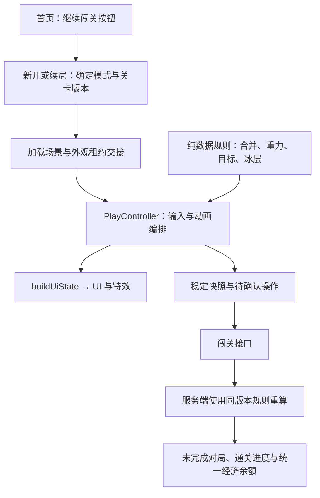

# 闯关模式架构设计

## 2026-10-28 实施边界更新

用户已明确开始搭建实际场景，并要求闯关与无尽模式不共用玩法脚本。当前实现改为独立 `assets/scence/level.scene` 与 `assets/script/level/`，下文关于复用 `PlayController`、`PlayUIController`、`OngoingGameSession` 及纯规则提取的早期建议不再作为实现依据。2026-10-30按反馈复用设置界面，将现有设置样式整理为`SettingsPopup.prefab`，共用设置展示组件与平台分享适配；无尽玩法脚本和`game.scene`不改。

首页增加静态“继续闯关 · 第N关”入口；闯关拥有独立数字块／冰层预制件、手动落子、收集与破冰目标、暂停结算及设备本地续局。木块本轮按固定障碍实现，不移动、不可消除。三个起始关卡用于验证玩法闭环，关卡平衡仍需实际游玩评审；不增加体力消耗、奖励、服务端协议或云存档。[搭建与验证说明](闯关场景搭建说明.md)。

以下保留2026-10-27至2026-10-28的早期架构草案，供追溯；当前实现边界以上述更新和《闯关场景搭建说明》为准。早期阶段只交付设计文档与图片原型，未实施客户端或服务端代码。

## 2026-10-28 范围更新

- 用户已明确回到格子合成，先设计数字收集和破冰两类。暂不做“合成到指定数字即通关”的合成目标关，基础数字合并仍保留。
- 五颗任选已取消。恢复单颗待落、下一颗预览，按出子顺序使用；不保留候选池、选中项或从多颗中挑选的设计。
- 本轮不引入水球弹射、墙面反射或物理系统。现有 `waterball-1024.html` 保留为独立探索，不作为本轮实现依据，也不修改该文件。
- 用户进一步明确不要改棋盘样式，应调整道具、得分和目标。当前图片原型保留原草地、方块、盘面布局与落子引导线，撤回棋盘边框、底板和全格线；先按无道具栏、不显示得分制作，以关卡目标及完成数量为重点。“手账挑战册”和第七版棋盘装饰不作为当前设计方向；本轮只做设计。
- 本文后续闯关技能、技能联网与消费内容仍是早期建议，当前无道具原型暂不采用，正式规则需随本轮评审调整；没有修改经典／无尽模式现有道具、计分或库存逻辑。
- 用户新增确认木方块不可消除；本轮[第十版外观设计](../design/闯关模式原型/v10/README.md)重做冰壳并展示无数字、无破损状态的木块。木块是否随重力移动、如何配置及影响落点尚未定义，也尚未纳入本文后续规则模型；本轮只做外观设计，不把木块列为清除目标。冰壳裂纹仅为破冰动画关键帧，不新增耐久等级。

## 1. 已确认的玩法边界

当前闯关先设计两类，共用现有格子数字合成和重力规则：

| 类型 | 目标 | 核心体验 |
| --- | --- | --- |
| 数字收集关 | 累计合成指定数字及数量 | 安排不同目标的合成顺序 |
| 破冰清除关 | 清除指定格子的全部冰层 | 在目标位置制造合并 |

- 闯关取消自动下落，当前棋子在顶部悬停，玩家点击目标列后落下；只预览下一颗，按顺序出子。
- 不设步数限制、不设倒计时；不展示剩余步数，不以操作次数或游戏时长判负。
- 完成全部目标即可通关；完整结算后仍未完成目标，且没有可落子列时失败。
- 同一次操作既完成目标又填满棋盘，优先判定通关。
- 闯关点击满列只提示，不自动换列；经典模式原有自动下落、选列与满列处理保持现状。
- 收集进度来自合并过程，棋子继续留在棋盘参与后续合并。
- 首页通过一个“继续闯关 · 第N关”按钮进入，不单独做关卡选择页、列表、网格或选择弹窗。路线场景留待后续设计。

本文中的模块名、字段名、接口路径与表名均为拟议契约，不表示当前已经存在。技能、体力、奖励、解锁和离线规则尚未由用户逐项确认，本文给出可实现的建议，并在第 12 节集中标明。

## 2. 现状与设计约束

只读检查时，客户端位于 `codex/level-mode`，提交为 `6da8582`；服务端同名分支提交为 `2eb02da`。两个工作区均无未提交改动。本文不调整分支基线，不提交、推送或部署。

| 现有位置 | 已有职责 | 闯关接入边界 |
| --- | --- | --- |
| `assets/script/gameplay/PlayController.ts` | 下落、触摸、合并、重力、技能、结束与 UI 状态编排 | 保留唯一玩法编排入口，增加明确的模式入口和闯关结算出口 |
| `BoardModel.ts` | 组件棋盘查询、落点、空位与清理 | 继续操作 `PieceController \| null` 棋盘 |
| `BoardConfig.ts` / `BoardGeometry.ts` | 棋盘尺寸校验与坐标换算 | 所有关卡沿用尺寸边界和坐标体系 |
| `OngoingGameSession.ts` | 首页与玩法场景之间传递纯数据续局快照 | 扩展模式身份、关卡身份和闯关快照，仍不持有节点 |
| `PlayUIController.ts` | 接收 `buildUiState()` 结果并展示 | 承接目标、冰层和闯关结算展示，不计算通关 |
| `HomeSceneController.ts` / `LoadingSceneController.ts` | 新开、续局、场景切换与外观租约交接 | 传递明确的对局描述，不在加载外观时新开或扣费 |
| `PlayerCloudSyncStore.ts` / `PlayerSyncOutbox.ts` | 经济同步、幂等操作、经典成绩 | 保留原协议；闯关操作单独同步，经济仍只有一个最终余额 |
| 服务端 `src/services/player-sync-service.ts` | 玩家事务、经济恢复与操作应用 | 闯关复用同一玩家锁、余额和恢复规则 |
| 服务端 `src/schemas/player.ts` | 严格校验经典续局等数据 | 不把闯关快照直接塞入旧协议，避免被拒绝或误当经典 |
| 服务端 `sql/001_init.sql` | `game_scores` 预留 `stage` 与 `stage_no` | 预留字段不能代替关卡版本、未完成对局和首通进度 |

当前实际合并规则需要特别保留：同值四向连通块共 `n` 颗时，结果为原值乘以 `2^(n-1)`。例如三颗 32 一次合并会产生 128，不会实际产生一颗 64。局部连锁每次合并后还会对受影响列施加重力，再继续检查锚点。不能把它改写成普通两两合成。

## 3. 总体结构与状态所有权

继续复用 `assets/scence/home.scene` → `loading.scene` → `game.scene`。首页在现有开始游戏入口之外增加“继续闯关 · 第N关”按钮，不新增选关页或选关弹窗。已有续局直达和单场景预览继续支持。



状态按以下边界持有：

| 数据 | 所有者 | 其他模块如何使用 |
| --- | --- | --- |
| 不可变关卡定义 | `StageCatalog` | 按关卡 ID 和版本读取，不在对局中改写 |
| 当前组件棋盘、输入状态、动画状态 | `PlayController` | UI 只读，技能通过控制器发起 |
| 目标进度、冰层、出子状态 | `PlayController` 持有的闯关运行数据 | 由纯规则计算下一状态，视图不直接写入 |
| 切场景交接数据 | `OngoingGameSession` | 传递快照，不传组件或回调 |
| 已确认关卡进度、本地恢复快照、待同步命令 | `StageProgressStore` | 接收完整纯数据记录，不直接修改场上棋盘 |
| 账号最终通关进度与经济余额 | 服务端 | 客户端保存带版本的缓存和未确认结果 |

`StageProgressStore` 中的恢复快照是不可变检查点，不是另一份可随时修改的玩法棋盘。规则计算中的数字矩阵也是一次操作的临时输入与输出，不替换项目要求的组件棋盘。

首版不引入玩法插件注册、全局规则事件总线、依赖注入框架或各目标一套模式控制器。两种目标通过判别字段和有限分支完成；暂不实现合成目标关的占位分支。

## 4. 关卡配置与目标规则

### 4.1 一份不可变关卡定义

| 字段 | 含义与约束 |
| --- | --- |
| `stageId` | 稳定关卡身份，不能用展示序号代替 |
| `order` | 展示与解锁顺序，和 ID 分开 |
| `definitionVersion` | 本关内容版本；修改初始盘面、目标或出子池均产生新版本 |
| `rulesVersion` | 合并、出子、目标与冰层规则版本 |
| `boardConfig` | 沿用 `BoardConfig` 校验，默认 5×7，不放宽当前布局支持范围 |
| `initialBoard` | 数字矩阵，行自下向上，列自左向右 |
| `piecePool` | 可生成数字集合，首版使用明确、无重复的等概率集合；有放回抽取，连续两颗可以同值 |
| `goal` | 下表中的两种目标之一 |

| `goal.kind` | 目标数据 | 判定建议 |
| --- | --- | --- |
| `collect` | 多个 `{ value, count }` | 按每次真实合并的结果值，累计对应数字的产出数量 |
| `clearIce` | 与棋盘同尺寸的初始冰层矩阵 | 所有格子的剩余冰层均为零 |

首版每关只有一种目标。收集关没有冰层，破冰关必须有至少一层冰，不提前组合多目标关，也不叠加达到某个大数字的通关要求。

收集采用精确结果匹配：三颗32合成128时，只产出一个128，不虚构一个64的收集记录。初始棋子、出子或普通落地不计入收集；真实合并产生过的目标数字，即使在同一连锁中继续升级，已获得的收集进度仍保留。

### 4.2 冰层使用独立格子数据

- 运行态保存 `iceLayers[row][column]`，数值为剩余层数；零表示无冰。
- 冰层固定在格子上，不跟随棋子下落、交换或销毁，不改变落子与重力规则。
- 每次真实合并，记录合并前全部成员所在格子，包含锚点和被吞并棋子；这些格子的冰层各减少一层，最低为零。
- 同一次合并涉及同一格只能扣一次；同一落子发生后续连锁并再次涉及该格，可以再次扣层。
- 普通落地、重力经过、交换动作本身不去冰。
- 冰层视图放在独立展示层，格子坐标仍通过 `BoardGeometry` 换算；不另建棋盘装饰或碰撞网格。

### 4.3 配置校验

配置加载失败时明确拒绝开始该关，不能静默回退成空棋盘经典局。至少校验：版本可识别、棋盘尺寸与矩阵一致、数字合法、目标数量为正、收集目标不重复、冰层矩阵合法且存在目标。

初始棋盘应是稳定局面：没有悬空棋子，也没有已可合并的同值相邻块。开局不先自动结算初始布局，避免进入关卡就获得收集或除冰进度。非终局快照必须保存合法的当前与下一颗数字，二者允许同值。

可通关性需要另外验证，结构校验不能证明关卡有解。至少为每个候选关卡保留可通关操作样例；随机关还需检查多种出子序列的失败率和容错空间。

## 5. 一次操作如何结算

### 5.1 输入与结果

闯关的有效命令只描述玩家动作，例如“向第几列落下当前棋子”“锤击哪个格子”“交换哪两个格子”。服务端从其保存的当前棋子确定数字，不接受客户端任意指定数字或改变出子顺序。

落子流程：

1. 检查模式、暂停、动画状态、当前棋子和目标列；满列或棋盘外点击无效，不消耗当前棋子，不推进下一颗或随机游标。
2. 锁定本次列与当前数字，计算完整操作的有序结算计划，并让悬停棋子开始下落。本次下落开始后冻结普通输入，直到完整结算。
3. 按现有顺序执行：落点局部连锁（含受影响列重力）→ 全盘重力 → 全盘同值连通块合并 → 重复至稳定。
4. 每次真实合并产生目标事件，使用合并前坐标处理冰层，并累计真实产出的数字。
5. 稳定后先检查目标全部完成，再检查棋盘无可落子列。
6. 若本局继续，原下一颗成为新的当前棋子，按固定算法只抽取一颗新的预览；若已通关或失败，不推进出子、不创建新的待落棋子。棋盘终态、当前／下一颗与随机游标一并写入稳定检查点。

出子推进属于本次有效动作的数据结果，只能提交一次。节点创建、动画完成或离场后的晚到回调不能再次抽取数字。等待输入时仅当前棋子悬停，预览只展示，不提供交换或选择入口。

目标在本次操作中一旦达成即保留；不会因为目标数字又在后续连锁升级、被消除或离开原格而回退。成功弹窗仍等待全部动画结束后展示。

技能完成后也走同一个目标与胜负检查出口，不能只有普通落子能通关。满盘已经判负后，首版不自动进入技能救场或复活分支。

### 5.2 小型状态流程

```text
等待输入 → 落子动画 → 合并／重力结算 → 等待输入
                                  ├→ 通关
                                  └→ 失败

等待输入 → 技能选中 → 有效技能执行／结算 → 同一胜负判定出口
```

暂停是上述流程之外的输入门控，网络确认状态也单独保存，避免把“等待服务端”误当作玩法失败。取消技能回到等待输入，不推进出子、不产生目标进度。

局内保留命令顺序号 `seq` 仅用于同步、去重和恢复；它不表示可用步数，不设置单局总次数上限，也不显示在玩家界面。

### 5.3 纯规则与动画的边界

建议从现有实现提取不依赖 `cc` 的规则计算，返回有序的落子、合并批次、重力移动、技能变更和目标事件。全盘同一批合并保持并行展示，批次之间保持原结算顺序。

客户端继续持有组件棋盘，按计划调用已有动画并在原来的提交节点更新棋盘引用。规则计算不操作节点、资源、Tween、音效、库存或网络。动画回调也不重新计算目标、奖励或合并结果。

这项提取只围绕现有规则展开，不重建一套通用数值棋盘框架。经典接入共享计算前，必须以当前实现进行同盘面、同输入、同随机条件的对照；不能只验证最终数字，还要比较锚点、分组、重力、计分和批次顺序。

## 6. 客户端模块与场景接入

以下是职责位置，后续实现时按需要新增文件，不要求一个类型单独建一个文件。

| 拟议位置 | 职责 |
| --- | --- |
| `gameplay/rules/BoardRules.ts` | 从现有玩法提取的纯合并、重力与技能规则计算 |
| `stage/rules/StageRules.ts` | 目标累计、冰层变化、胜负和确定性出子 |
| `stage/StageTypes.ts` | 关卡定义、运行态、快照、命令与 UI 契约 |
| `stage/StageCatalog.ts` | 读取、校验和缓存按版本固定的关卡配置 |
| `stage/StageGoalView.ts` | 展示收集、破冰两类目标与进度，仅发出用户操作意图 |
| `stage/StageIceView.ts` | 展示固定格子的冰层和破冰动态表现 |
| `online/stage/StageProgressStore.ts` | 已确认进度、恢复检查点、待确认命令与接口同步 |

对现有入口的改动边界：

- `HomeSceneController` 明确区分经典入口和首页“继续闯关”按钮。闯关入口优先恢复已有对局，没有未完成对局时进入当前待通过关卡；不新增选关控制器或弹窗。
- `OngoingGameSession` 传递带 `mode` 的对局描述；现有 `beginNewGame(config?)` 继续表示经典，新增闯关入口显式携带关卡与对局身份。
- `LoadingSceneController` 只加载和交接外观，按模式选择操作提示，不创建新对局、不扣体力。
- `PlayController` 在进入、处理输入、操作结算、结束四个位置做明确模式分流；合并、重力与技能计算共用。
- 闯关等待输入时保留当前棋子，但不执行经典自动下落。点击有效列后才进入下落状态；当前悬停不会额外产生消费、目标进度或出子。
- `buildUiState()` 加入模式和闯关展示数据；闯关不进入经典冲榜、经典金币结算或 `recordGameFinished()`。
- 闯关UI沿用当前棋子与下一颗展示，补充收集／破冰目标和手动落子提示；复用现有预览视图，不新增候选视图或选中态。经典原有预览和引导保持现状。
- 闯关结算以成功／失败、目标结果与确认状态展示。布局可复用现有结算容器，但业务回调与经典结算分开。
- 首页闯关按钮、静态目标区和结算布局由 Creator 维护。冰层格子属于按配置生成的动态实例，不通过脚本重复搭建整页静态 UI。
- 资源仍通过现有外观加载与租约管理。关卡定义不包含外观配置、资源 UUID 或运行脚本；后续冰层素材归入 `base` 下的对应功能目录。

没有传入模式的原单场景预览保持经典行为；闯关预览必须显式提供测试关卡，且不提交账号进度或奖励。

## 7. 续局、持久化与出子

### 7.1 快照保存稳定结果

闯关快照至少携带：快照版本、模式、`attemptId`、关卡ID、内容版本、规则版本、棋盘尺寸、数字棋盘、当前与下一颗数字、当前列、随机状态及出子游标、目标进度、剩余冰层、已用技能、确认顺序号和未确认命令。

当前位置与节点动画不是闯关恢复依据。有效动作接受后，先计算稳定终态，将“终态检查点＋待同步命令”作为一个本地记录持久化成功，再播放动画。若此时离场，恢复到该动作已经结算完成的局面，不读取半截动画中的组件棋盘。

本地保存失败则不接受新动作，保留原局面并提示处理存储问题。离场回调不能再重复累计目标或消费资源。服务端已经确认、但客户端尚未落盘的技能操作，通过读取同一 `attemptId` 恢复，不能重开或重新扣费。

### 7.2 经典与闯关分开保存

建议每个账号分别保留一局经典和一局闯关，进入闯关不会覆盖经典续局。`OngoingGameSession` 只是当前入口的交接通道；本地持久化仍按模式分开，未完成闯关由 `StageProgressStore` 保存。

所有闯关缓存、检查点和待确认命令按接口地址与账号隔离，沿用 `getPlayerAccountStorageKey()` 约定；账号切换后，旧请求不能写入新账号。旧无模式快照只识别为经典。

恢复时必须同时匹配关卡ID、内容版本、规则版本与棋盘形状，并校验当前／下一颗数字。版本不匹配不能套用最新配置或静默清空棋盘；在线对局从服务端读取其冻结定义与确认状态后恢复。出子数据缺失时不能在本地重新随机补齐；有效非终局检查点的当前棋子恢复到顶部等待手动落子。

### 7.3 出子可重现

闯关使用服务端生成的种子和固定算法出子，算法及取池映射包含在 `rulesVersion` 中；不能使用帧时间、节点动画或 `Math.random()` 决定正式闯关数字。

新开一局按种子依次确定当前棋子和下一颗。每次有效落子完整结算且本局继续时，原下一颗移为当前，再补抽一颗预览；按顺序使用，不提供多颗任选、暂存或换牌。

当前、下一颗和随机游标一起进入快照；暂停、返回首页、加载重试与无效触摸不推进出子。技能不消耗当前待落棋子、不改变预览、不推进出子。新重试是新对局，续局保留原当前、下一颗和后续序列。

固定种子用于一致性验证和恢复，不承诺随机关每种序列都必胜，也不将种子保密当作结果可信的依据。

## 8. 服务端配置、接口与验证

### 8.1 单一配置来源与规则来源

建议关卡定义以服务端仓库版本化 JSON 文件为正式来源，启动或发布检查时校验。客户端获取列表摘要，在开始对局时取得本局完整定义；首版不建设关卡编辑后台。

创建对局时，服务端冻结本关定义和规则版本，保存到对局记录。发布新关卡版本不覆盖进行中的局；仍有未完成对局的规则版本必须能恢复，不用强制过期形成变相限时。

客户端和服务端必须使用同一份纯规则来源。建议源文件放在客户端不依赖 `cc` 的规则目录，通过维护工具生成服务端 `src/generated/stage-rules/`，同时记录源提交、规则版本与内容摘要；生成目录禁止手改。关卡配置的反向导出使用独立清单，避免来源混淆。

共享内容只包含棋盘规则、目标／冰层规则、出子和必要契约；不包含 Cocos 展示、平台能力或账号经济。发布前检查摘要与确定性样例，不各自手写一份“看起来相同”的服务端规则。

纯规则提取和两端一致性验证是可信进度上线的前置条件；未完成前，只能做本地预览，不能先信任客户端的通关声明发奖。

### 8.2 拟议接口

下表为 `/v1` 内路径，仍通过现有鉴权和 `GameApiClient` 的请求／错误封装访问。

| 接口 | 用途 | 关键契约 |
| --- | --- | --- |
| `GET /stage/catalog` | 关卡摘要与版本 | 返回有序列表和支持的规则版本 |
| `GET /stage/progress` | 已确认通关记录与未完成对局身份 | 客户端据此展示解锁和续局 |
| `POST /stage/attempts` | 开始一局 | 客户端请求 ID、关卡 ID 和期望版本；服务端校验解锁，生成种子与对局 ID |
| `GET /stage/attempts/:id` | 查询、恢复或处理超时 | 返回冻结配置、服务端检查点和确认顺序号 |
| `POST /stage/attempts/:id/actions` | 增量提交有效动作 | 请求ID、起始确认号、连续命令与可选结果摘要；落子命令携带列号 |
| `POST /stage/attempts/:id/abandon` | 明确放弃未完成对局 | 幂等关闭本局，不能由进入另一个关卡静默触发 |

动作接口在服务端验证到成功时，直接在同一事务内确认通关和奖励，不另设一个接受客户端 `success=true` 的通关入口。

服务端使用其保存的盘面、当前／下一颗、种子和目标状态逐条重算，验证落列后按顺序消耗当前棋子。客户端提交的数字棋盘、当前／下一颗、收集数量、冰层和结果摘要只用于校验与定位差异，不能成为事实来源。

请求按批次限制大小，例如每批最多 100 条命令；这是传输分批，不是单局操作上限。每批从已确认检查点继续计算，不在最终通关时重放无限增长的整局日志。

### 8.3 幂等、冲突与失败

- 新开请求按账号与请求 ID 去重。超时重试返回原对局，不创建第二局、不再次扣体力。
- 动作按 `attemptId + requestId` 去重，并保存请求内容摘要；同 ID 不同内容拒绝处理。
- 每批命令顺序连续，整批验证后原子提交；错误批次不部分扣库存或部分推进目标。
- 已完成请求重试先返回确认信息，再考虑对局是否终态；不能因“已经通关”拒绝原成功请求的重试。
- 接受后的响应返回当前确认号与当前检查点。旧响应不能覆盖客户端较新的本地操作或经济版本。
- 多设备提交不同后续命令时，拒绝冲突分支并提供最新服务端状态；不按“谁的进度更高”合并盘面或目标。
- 网络错误保留相同请求 ID 和原命令重试。身份过期先恢复同账号登录，不清空对局。
- 校验失败不强行上报成功。保存差异信息，恢复到服务端检查点；未确认动作的回退需明确提示。

每条命令在有限棋盘上计算，合并会减少棋子数量，结算应能在有界轮次内结束。实现仍需保护异常循环、非法数值与单批开销，但不能用技术保护直接判玩家因“操作太多”失败。

## 9. 数据库存储与经济一致性

建议新增以下三张表，迁移文件使用执行时下一个可用序号；不修改已经执行的 `001`～`006`。

| 拟议表 | 核心字段与唯一约束 | 职责 |
| --- | --- | --- |
| `player_stage_progress` | 玩家、关卡 ID；两者唯一；首通时间、通过的内容版本、首通奖励凭证 | 已确认关卡进度与首通去重 |
| `stage_attempts` | 对局ID；玩家＋新开请求ID唯一；关卡冻结定义、规则版本、种子、状态、确认顺序号、稳定检查点（含当前／下一颗与随机游标） | 新开、续局、增量验证与最终结果 |
| `stage_action_batches` | 对局＋请求 ID 唯一；命令范围、内容摘要与确认凭证 | 重复请求去重与必要排查，不为每批重复保存完整盘面 |

每账号建议只允许一局未完成闯关。创建、动作提交、放弃和旧经济同步统一先取得已有玩家行锁，再按固定顺序访问云余额、对局和进度，防止相互覆盖或锁顺序相反。

沿用现有 `player_cloud_states` 保存唯一经济余额，不另建一套闯关金币、体力或技能库存。

建议的事务边界：

- 新开：校验账号与关卡解锁 → 检查幂等／已有对局 → 应用现有自然恢复规则 → 扣本局体力 → 保存对局 → 增加云余额版本 → 提交。
- 使用库存技能：验证动作及本局次数 → 扣一次对应库存 → 保存动作检查点和确认凭证 → 增加云余额版本 → 提交。
- 首通：验证成功 → 写首通记录 → 发放配置中的首通奖励 → 关闭对局 → 保存动作凭证与新云余额版本 → 一次提交。

闯关的新开与库存技能不能再额外入队一条旧 `energy_consumed`／`skill_consumed` 重复扣费；应复用经济规则和显示状态，而不是重复调用消费入口。客户端需统一应用所有接口返回的经济版本，保留旧同步对未确认经典操作的处理。

闯关成绩不更新经典最高分、经典冲榜和经典完成局数。首版也不引入闯关排行榜、星级或按步数／耗时评级。

## 10. 联网、技能与展示生命周期

建议首版正式闯关在登录且联网时新开，创建成功后普通落子可以暂时离线进行；达到本地目标时显示待确认，服务端确认前不解锁下一关、不发放正式奖励。游客可使用独立本地预览，不导入未经验证的通关记录。

普通动作在本地稳定保存后立即展示，后台按批次同步。库存技能建议在线确认后执行：先提交此前普通落子，再验证和扣除本次技能，成功后播放。网络超时查询同一请求结果，不先播放再重复扣费。这样首版无需增加离线库存预授权体系。

技能建议保持现有三种操作。锤子／炸弹直接清除棋子本身不属于合并，不累计数字收集，首版也不直接去冰；技能引发的后续真实合并正常累计目标和去冰。广告额外技能次数需有可验证授权后再接正式闯关，不能把客户端“播放完成”回调直接作为服务端库存凭证。

未确认命令不能因长度或存储不足被丢弃。缓存接近可用容量时暂停接受新输入并提示同步，保留当前局；它不是关卡失败或新增步数限制。

新增 UI 与异步入口遵循已有生命周期要求：

- 首页闯关按钮、目标、冰层和结算视图只持有展示数据及用户意图回调。
- 外观继续使用 `AppearanceAssetLoader` 和租约；不逐落子加载共享贴图。
- 网络响应同时核对接口地址、账号、对局身份和任务代次，再更新缓存或访问视图。
- 离场先标记取消并解绑监听，停止自有 Tween／定时回调；清理缓存引用前检查 `isValid`，不遍历已毁子层级。
- 已接受动作的稳定终态不依赖动画 Promise 才落盘。动画中离场后，晚到回调不能再次推进目标、生成棋子或展示弹窗。
- 棋盘装饰仍只有 `PlayUIController.ensureBoardDecorations()` 一个入口，技能栏继续兼容现有两种节点名。

## 11. 后续实现顺序与验收

本文仅设计，以下各阶段均未执行。

| 阶段 | 后续工作 | 退出条件 |
| --- | --- | --- |
| 1 规则边界 | 固定现有规则样例，提取纯计算与收集／破冰目标数据 | 合并、锚点、重力、批次和计分与当前一致；经典玩法无行为变化 |
| 2 本地闯关 | 单颗待落与下一颗预览、手动落子、收集／破冰、检查点与恢复 | 两类局部预览可玩，暂停、离场和重复恢复不重复累计或重抽出子 |
| 3 服务端闭环 | 规则生成与版本检查、新表、对局接口、增量验证、经济事务 | 服务端自行确定通关；重复新开、技能与首通不重复扣费／发奖 |
| 4 入口与展示 | 首页闯关按钮、目标 HUD、模式提示、成功／失败展示 | Creator 引用与常规屏／长屏核验，经典入口与结算保持现状 |
| 5 联调与内容 | 开发环境联调、关卡解法样例与随机序列检查 | 进度一致、配置可恢复、难度经过实际试玩；再决定发布 |

关键自动化样例：

- 三颗同值直接跨级；全盘多个组同批合并；局部重力后继续连锁；锚点重力移动后继续合并。
- 真实产出的目标数字在同一操作中继续升级仍计收集；多棋直接跨级不虚构中间数字；初始棋子／出子／普通落地不计收集。
- 冰层包含锚点与吞并格；同次合并去重；同一格后续连锁再次去冰；重力和直接销毁不误计。
- 完成目标同时满盘优先通关；所有技能结算后都检查目标；无效点击不推进出子或命令号。
- 当前／下一颗可同值；当前只在有效落子时使用，结算继续后原下一颗成为当前；满列、暂停、技能与续局不重抽；重复提交和晚到动画回调不重复推进出子；终局不补抽。
- 同种子和同命令在两端输出相同盘面、事件、目标、冰层和随机游标；任何摘要不一致均阻止确认。
- 新开重试、首通重复、多设备并发、旧经济响应、技能超时、账号切换与离线重连。
- 动画中退出、保存失败、配置更新后恢复、子节点先毁并清空字段、迟到回调与重复释放。

实现后按变更运行相关 `tools/verify-*.cjs`、Creator 自带 TypeScript 类型检查、涉及集合遍历的 loose 编译检查及 `git diff --check`。服务端实现后运行类型检查、构建和测试；新增迁移仅在开发库验证，并检查开发健康接口。

脚本验证不能替代 Creator、微信和真机验收。UI／资源实现时再读取对应本地技能，并验证透明区域、运行时尺寸、资源引用与主包预算。本次没有运行上述实现验证，也没有创建或执行数据库迁移。

## 12. 建议默认值与实现前需要明确的产品项

以下条目用于让架构形成可落地方案，尚不等于用户已经逐项确认：

| 项目 | 本文建议 | 架构影响 |
| --- | --- | --- |
| 冰层触发 | 每次合并涉及的格子各减一层，包含锚点 | 决定事件与冰层计算契约 |
| 三技能与去冰 | 保留库存技能；直接销毁不去冰，后续合并可去冰 | 不混淆消除棋子和合并事件 |
| 技能联网 | 普通落子可离线，库存技能在线确认 | 首版不增加库存预授权系统 |
| 广告技能 | 可验证授权具备前不接正式闯关 | 不改变经典广告技能路径 |
| 开始与重试体力 | 沿用现有每局成本；续局和加载重试不扣费 | 新开对局事务是唯一消费入口 |
| 关卡推进 | 按顺序进入当前待通过关卡，已有对局优先恢复；重玩入口另行设计 | 首页只保留已确认的继续闯关按钮，不提前引入选关界面 |
| 奖励 | 首通奖励由配置确定，重复通关不重复领取 | 金额与品类另定，不在客户端自行发放 |
| 并行续局 | 分别保留一局经典和一局闯关 | 模式之间不覆盖存档 |
| 游客 | 本地预览，正式进度登录后验证 | 不把游客快照直接导入已确认首通 |
| 数值边界 | 明确闯关规则的最大值与到顶处理后再上线 | 当前服务端数字上限为 `2^30`，现有多棋合并可能跨越；不能由一端截断、另一端继续计算 |

当前架构仍为设计方案；[第九版任务区](../design/闯关模式原型/v9/README.md)和[第十版冰壳／木块外观](../design/闯关模式原型/v10/README.md)保持原棋盘样式，无道具栏和得分，尚待视觉与交互评审。目标反馈由真实规则事件驱动，展示更新不改变棋子归属和结算顺序。玩法规则保持单颗待落与下一颗预览，只包含收集、破冰两类，首页继续使用单一闯关入口；新增木块不可消除，具体移动与落点规则尚待设计。早期技能建议暂不作为本轮原型依据，手账风、合成目标和五颗任选旧图仅保留迭代记录。未修改代码、场景、运行资源、接口或数据库，未执行 Creator／微信／真机验证，也未推送或部署。
