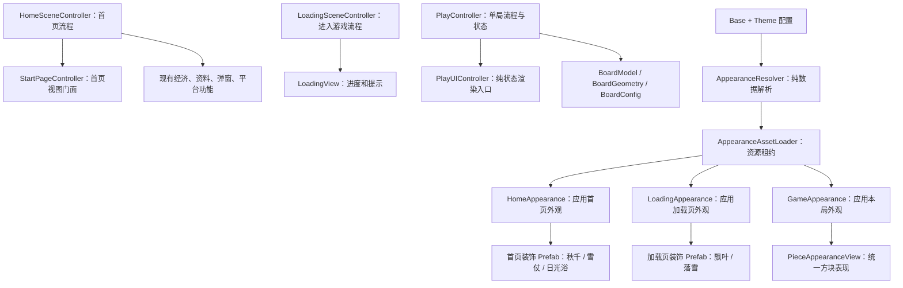

# 重构设计：场景组合与外观解耦

日期：2026-10-23。状态：设计方案，未实施。

实施交接补充见 [重构交接-现状依赖与迁移验收](重构交接-现状依赖与迁移验收.md)。其中补充了深读后发现的续局直达、场内重开、账号同步、平台生命周期和构建后资源处理约束；实施时必须与本文一起阅读。用户本次只要求方案，代码改动交由后续模型执行。

## 1. 目标与边界

### 硬性约束：玩法与表现等价

本次重构只能改变内部代码组织与依赖关系，不能改变当前游戏玩法或表现。此约束优先于本文中的目标结构、示例和阶段建议。

- 玩法不变：数值、随机取值规则、合并与重力顺序、技能作用与消耗、计分奖励、体力、引导、暂停、续局、结算及联网操作语义均保持现状。
- 表现不变：布局、层级遮挡、资源、颜色、字体、尺寸、动画轨迹/时长/缓动/触发顺序、粒子、声音、交互反馈、加载页停留与进度显示均保持现状。
- 原有平台差异、兼容路径和失败回退先保持。疑似缺陷记录为独立问题，不借重构顺手修复；若内部调整无法保持行为等价，停止该项迁移并说明，不自行选择新行为。
- 主题、独立表现组件等设计仅提供未来扩展边界。本轮不新增或启用冬日/海滩主题、不替换现有活动表现、不新增入口或改变页面跳转。
- 验收以同输入、同初始状态及受控随机/异步条件下的前后等价为准。可读性改善、文件变短或性能提升不能抵消玩法和表现回归。

目标不是减少文件数量，而是让一次需求只有明确、有限的修改位置。公共能力统一维护，每个场景仍能独立增加布局、交互、展示内容和动画。用户提到的秋千、打雪仗、飘叶只是说明场景自主性的例子，不是架构必须实现的功能清单，也不是固定的扩展类型。

架构应围绕稳定职责设计：场景流程、业务功能、视图、局部表现和资源管理。主题切换只是使用这些边界的一项功能，不应成为所有场景能力的总入口。与主题无关的场景功能可以直接由场景组合，不需要登记进主题配置。

本方案补充《开发方案-游戏主题切换与方块皮肤》的客户端架构，不覆盖其中已有的用户修改。Base + Theme 两层解析继续保留；服务端权益、碎片、成绩审核不作为本次重构的前置条件。

本轮不重写玩法、不更改棋盘尺寸规则、不改变经济与同步协议、不实现通用 UI 引擎。仍保留 `board[row][column]: PieceController | null`、`PlayController.buildUiState()` 与 `PlayUIController.renderState()` 的职责边界。纯数值棋盘模型是将来可以单独评估的工作，不混入本轮。

## 2. 现状依据

本次检查的代码规模：PlayController 2998 行、PlayUIController 2528 行、StartPageController 2202 行、HomeSceneController 802 行。行数仅是定位线索，不作为强制拆分指标。

具体耦合比行数更重要：

- StartPageController 同时绑定已有层级、动态创建完整备用页面、加载首页素材、组装秋千、布局按钮、管理排行榜和提示。
- HomeSceneController 已承担流程协调，但也持有弹窗节点及资源加载细节。
- PlayUIController 同时管理背景、棋盘装饰、HUD、下一颗样式和技能区域。
- PieceStyle 提供棋子色阶，HUD 另有色表，结算直接读取默认样式；临时棋子只复制主体贴图与颜色。
- LoadingSceneController 将场景预加载、页面构建、背景和飘叶模拟放在一起。
- BoardModel 直接依赖 PieceController、Tween 和 UIOpacity，不能把它当成现成的纯数据层。

### 2.1 可读性与耦合分别治理

可读性差表现为流程难以顺序阅读、命名不明确、多个抽象层次混在同一方法中；耦合强表现为修改一个功能必须了解并修改其他模块的内部实现。把大文件拆成多个文件，只能改善部分阅读体验，不能自动解除耦合。

若拆出的模块仍互相访问内部字段、共享可写状态、接收整个控制器作为上下文，或者通过全局事件间接调用彼此，本次重构仍视为没有完成解耦。

### 2.2 现有耦合及处理边界

| 耦合问题 | 当前证据 | 本轮处理 | 暂时保留的限制 |
| --- | --- | --- | --- |
| 棋盘数据与引擎组件耦合 | BoardModel 保存 PieceController，且依赖 Tween、UIOpacity | 将动画执行移至表现侧；限制组件棋盘访问范围，纯计算尽量接收只读数值快照 | 保留项目规定的组件棋盘存储，不能宣称已完成纯数据模型 |
| 玩法流程与视觉执行耦合 | PlayController 编排结算，也创建临时棋子和技能特效 | 流程发出明确表现请求，表现返回完成或取消结果 | 结算顺序仍由 PlayController 统一负责 |
| 场景与具体页面构建耦合 | StartPageController 同时绑定层级、构建备用页面、组装装饰和加载资源 | 分离视图绑定、布局、局部表现及资源入口，场景只显式组合 | 历史备用路径在确认引用与用途前保留 |
| 同一外观规则多处实现 | 方块色阶、HUD 色表、结算默认样式分散 | 统一样式计算，展示端只应用结果 | 不要求所有展示使用同一个有玩法行为的组件 |
| 资源与消费者生命周期耦合 | 场景、预览、棋子和临时表现可能共用素材 | 以租约明确所有权与交接；节点销毁不直接销毁共享资产 | 是否真正无泄漏仍需运行验证 |

本轮是有明确边界的阶段性解耦。将组件棋盘改为纯数据棋盘，需要单独调整项目约定、设计节点映射并验证完整玩法，不在外观重构中顺带完成。

## 3. 总体结构

采用“场景负责组合，功能负责业务，表现负责节点，公共层负责资源”的结构。



依赖约束：

1. 业务控制器知道“开始、暂停、结算、领取”，不读取外观资源路径，也不查装饰子节点。
2. View 渲染数据、发出回调；不直接修改游戏状态或经济仓库。
3. Appearance 组件只处理外观，不能开始对局、加分、消费体力。
4. 装饰组件只拥有自己的子节点，不引用兄弟场景或玩法控制器。
5. 配置、解析器和样式计算不导入 `cc`；节点绑定和资源加载可以导入 `cc`。
6. 优先显式参数与回调，不引入全局事件总线、依赖注入框架或新的万能 Manager。

### 3.1 四条解耦契约

**状态所有权。** 每类业务状态只有一个权威修改入口。View、装饰和特效不得通过组件引用改写棋盘、分数、经济余额或主题权益。局部动画进度等表现状态由所属组件自行管理，不回写业务状态。

**依赖方向。** 规则计算不依赖节点、动画或资源加载；流程依赖明确的表现操作契约，不依赖表现内部节点。场景入口可以认识具体实现并完成接线，但被组合的模块不能反过来依赖整个场景控制器。现有 BoardModel 的组件依赖是明确保留的例外，应收敛而不是扩散。

**输入输出。** 通过必要的只读数据、明确的操作方法和回调协作。避免传入整个 PlayController、HomeSceneController、可写棋盘或万能 context。不要为了“接口化”给每个类机械创建接口；存在跨边界调用或替换需求时才定义小契约。

**生命周期。** 节点、监听、Tween、定时器和资源租约都有明确所有者。转移所有权必须有明确的接管步骤；调用者不能假设停止动画后等待任务会自行结束，也不能假设销毁父节点后仍能调用子组件。

### 3.2 模块协作示例

```text
用户点击技能按钮
  → SkillBarView 发出技能操作意图
  → PlayController 校验状态并决定执行
  → 表现模块接收必要的视觉目标与参数
  → 返回完成或取消结果
  → PlayController 在有效对局代次内继续结算
  → buildUiState() 生成新状态
  → renderState() 更新显示
```

表现完成只表示视觉任务结束，不授权表现模块加分或修改棋盘。动画期间的玩法变更仍由流程控制；退出导致取消时，流程不得继续生成棋子或执行晚到结算。

场景独立扩展也遵循同一原则：新增一个局部功能，由场景组装必要依赖；它不读取其他场景私有节点，不要求其他场景修改内部实现。灵活性来自独立模块的组合，不来自任意访问全局对象。

## 4. 三个场景分别怎么组织

### 4.1 首页

保留 HomeSceneController 的场景入口和序列化字段，逐步成为清晰的组装入口：初始化功能、订阅玩家状态、将状态交给视图、处理按钮意图。

| 模块 | 负责 | 不负责 |
| --- | --- | --- |
| HomeSceneController | 开始/续局流程、功能回调接线、场景离开 | 创建按钮图形、秋千运动、贴图路径 |
| StartPageController | 保留现有类名，作为首页视图门面，绑定按钮与渲染状态 | 请求排行榜、实例化主题角色 |
| HomeLayout | 安全区、屏幕适配、既有布局规则 | 用户状态、主题授权 |
| HomeAppearance | 背景、标题和按钮样式绑定，切换装饰 Prefab | 商店购买、动画内部细节 |
| HomePopupHost | 本场景弹窗实例、开关顺序、销毁 | 奖励和商店规则 |
| HomeSwingAnimator 等 | 单个装饰的具体动画 | 首页业务、其他装饰节点 |

已有功能弹窗及 Store 继续复用。HomePopupHost 仅在抽取现有节点管理时落地，不重新实现一个全局弹窗框架。排行榜请求由流程侧提供回调或数据，View 不自己访问网络。

首页中固定按钮、标题和资源条仍由 Creator 维护。旧代码中的多套备用页面先隔离到兼容路径，核实所有使用场景后再删，不一开始就整段删除。

### 4.2 加载页

- LoadingSceneController：并行准备 game 场景和本局外观，处理超时、失败与切场景。
- LoadingView：渲染进度、阶段文字、错误和重试意图。
- LoadingAppearance：绑定加载背景、进度条配色和装饰。
- LoadingLeavesEffect：从现有飘叶逻辑提取，独立管理粒子与更新；未来雪花组件可独立新增。

加载进度与装饰不互相控制。飘叶准备失败不阻塞 game 场景；已声明的必需主题资源失败则整套回退 Base。装饰是否为可选项必须在清单中明确，不能任意吞错。

加载页自身外观在进入该场景时准备；不必等 game 所需资源全部就绪才显示加载页。若尚未就绪，先显示完整 Base 加载页，再于有效任务范围内整套切换，避免空屏。

### 4.3 游戏页

PlayController 继续拥有单局状态、棋盘及结算顺序。第一阶段只剥离纯表现，不调整算法。

PlayUIController 保持 `renderState(PlayUIState)` 门面，委托明确的局部视图：

- PlayHudView：分数、金币、下一颗。
- SkillBarView：技能数量、可用状态、选中提示，兼容两个历史节点名。
- GameAppearance：背景及本局外观绑定。
- PieceAppearanceView：棋子图层、数字、配色和装饰。
- PlayEffects：合并、技能、临时棋子等视觉动画，复用 TransientFxRegistry。

棋盘装饰继续仅由 `PlayUIController.ensureBoardDecorations()` 绘制，本轮只让其接收解析配色，避免产生第二套绘制入口。布局继续使用 BoardGeometry 和 BoardConfig。

后续确有必要时，可以从 PlayController 抽出结算编排与技能执行模块，但它们不能各自持有另一份可写棋盘。先提取纯计算或视觉执行，再评估状态编排；不要在本轮同时改成 ECS、完整状态机或事件溯源。

## 5. 场景扩展：按职责组合，不按示例固化

场景扩展不限于装饰或动画。新增内容按职责接入：

| 新增内容 | 接入方式 |
| --- | --- |
| 局部视觉或动画 | 场景持有独立组件；有独立节点结构时使用 Prefab |
| 独立交互区域 | View 发出类型化操作回调，由场景或功能模块处理 |
| 新业务功能 | 放在对应功能目录，场景只负责接线，不塞进 Appearance |
| 场景布局变化 | 在该场景的 Creator 层级与布局组件中调整 |
| 随主题变化的外观 | 由场景 Appearance 应用主题配置 |

只有资源和显示确实随主题变化的内容才进入外观系统。不要求每个组件都可配置、可替换或实现统一接口，也不建立通用插件平台。场景可直接组合具体组件，共享代码仅在职责和行为确实相同时提取。

示意主题选择表：

| 主题 | 首页装饰 | 加载页装饰 | 游戏页装饰 |
| --- | --- | --- | --- |
| Base | 秋千 Prefab | 飘叶 Prefab | 原有默认表现 |
| 冬日 | 雪仗 Prefab | 落雪或滚雪球 Prefab | 边缘落雪，可关闭 |
| 海滩 | 日光浴 Prefab | 海风或休息小鸟 Prefab | 海浪边缘，可关闭 |

以上仅用于解释主题如何选择已有表现，不代表确认了这些功能、动画或固定槽位，不作为重构交付清单。

每个场景绑定自己的装饰挂载点。优先复用既有节点；需要新增挂载点时由 Creator 显式添加并验证，不改名或移除既有层级。装饰内部布局在 Prefab 中维护，不能让配置传入任意节点路径。

同一场景可有多个固定用途的槽位，例如首页主视觉与前景小装饰。只有真实需求出现时才增加槽位，不先造任意层级生成器。场景特有能力不强行统一：首页可以接受角色交互，加载页可以接受进度；通过具体组件的类型化方法传递。

共享的只是最小生命周期约定：

```ts
interface DecorationLifecycle {
  pause(): void
  resume(): void
  dispose(): void
}
```

它是设计契约，不是必须引入的基类。Prefab 可使用具体 Cocos 组件，场景通过已知组件引用接入。初始化参数由各表现自行定义；不传整套 Store、PlayController 或万能 context。

运行时顺序：准备候选资源 → 在非活动节点中实例化并完成初始化 → 检查场景和任务有效性 → 在同一同步步骤切换显示与外观 → 清理旧表现 → 释放旧租约。失败时销毁候选并保留旧表现。

Prefab 默认不得自动开启动画；由宿主激活后开始，避免预备期间偷偷播放声音或注册交互。

## 6. 外观公共层

保留原方案的小规模模块，不增加与它们功能重复的服务：

| 模块 | 产物/职责 |
| --- | --- |
| AppearanceTypes | 类型化资源标识、场景外观、方块样式 |
| BaseAppearance / AppearanceCatalog | 默认完整描述及本地主题覆盖 |
| AppearanceResolver | 按白名单字段合并和校验，不加载资源 |
| AppearanceAssetLoader | Bundle 及资产加载去重、引用计数、租约 |
| AppearanceRuntime | 当前显示所需的解析结果及租约，不持有场景节点 |

外观描述按用途分为 home、loading、game、piece、已接入的 shared UI 项。每个场景只申请自己的资源；进入游戏同时准备 game 和 piece，不为一局游戏预加载所有弹窗或全部主题。

从 A 切到 B 永远重新解析 Base + B。省略字段继承，`enabled: false` 表示隐藏可选装饰，必需资源不得清空。明确声明但加载失败是错误，不伪装成继承。

装饰 Prefab 也使用同一资源清单和租约，脚本行为随客户端发布。配置不能执行代码、改变棋盘参数或访问任意组件。

现有 Base 素材不搬家、不重建 UUID。Theme 按已确认 Bundle 方案组织；新增表现 Prefab 的依赖必须检查实际打包归属。图标与背景等素材继续遵循仓库对应技能和包体约束。

## 7. 方块外观只有一个来源

保留 PieceController 的数值与现有公开调用，表现细节委托 PieceAppearanceView：

```text
解析后的 PieceAppearance + value + displaySize
                  ↓
             方块样式计算
                  ↓
  棋盘棋子 / 下一颗预览 / 结算缩略图 / 临时表现
```

统一的是样式规则，不是强制所有场景实例化有玩法行为的 PieceController。预览和缩略图可以用轻量表现 Prefab，共用 PieceAppearanceView，不注册下落或触摸逻辑。

完整彩色贴图使用白色乘色；可染色图层按样式着色。数字继续用 Label。布局刷新和数值变化均读取已注入外观，不偷偷回默认色表。

当前临时棋子和技能碎片只复制主体贴图及颜色，这是现有表现基线，本轮必须保持，不能为了“统一”增加数字、描边或装饰。未来如需完整棋子影像，可另外定义表现接口，但不在本次重构中启用。统一样式来源不等于统一所有展示的图层数量。

## 8. 状态、切换与资源所有权

### 8.1 单一写入方

- 单局玩法状态：PlayController。
- 玩家经济、账号、同步：保留现有各 Store。
- 主题选择与权益：以后由 PlayerAppearanceStore 管理，本地阶段仅保存本地偏好。
- 当前显示资源：AppearanceRuntime 和租约。
- 节点和 Tween：拥有它们的场景组件或装饰组件。

禁止 View 另存一份可写业务状态。展示缓存可以存在，但必须能由输入状态重新生成。

### 8.2 loading → game 的交接

该交接只覆盖新局正常转场，不能作为游戏初始化的唯一入口。首页续局直接进入 game、game 内重开、Creator 直接预览及 loading 场景名为空的兜底入口，均需执行同一份外观准备契约；具体入口矩阵见交接补充第 3 节。

采用一个明确的待进入外观交接槽，由 AppearanceRuntime 管理，内容只包含纯描述、资源租约及转场代次，不包含节点。

1. loading 获得候选租约，预加载场景；任一步失败由 loading 释放尚未交接的资源。
2. 切场景前将租约转移到交接槽，loading 不再拥有它。
3. game 初始化时按代次取走租约；重复取走必须失败，不能有两个所有者。
4. 切场景失败、取消或下一次转场替换时，交接槽释放未被接管的租约。
5. game 退出时释放本局租约。OngoingGameSession 仅保存可选主题 ID/版本及原有纯数据。

### 8.3 后台恢复

本地主题阶段不引入到期校验。接权益以后，前台进行中的一局固定显示；后台恢复若必须回退，则先冻结输入，在动画安全边界或取消临时视觉后，原子更新所有现存棋子和 HUD，再恢复。不得只更新之后生成的棋子。

该行为应作为独立功能实现和验收，不能借重构默默改变现有暂停/恢复语义。

## 9. 生命周期必须可读、可追踪

- `onDisable` 用于暂停或解绑本次激活的监听；不能默认永久 dispose，因为节点可能重新启用。
- `dispose` 在开始立即设置释放标记，重复调用安全；`onDestroy` 只委托自身清理。
- 父级对子组件调用公共清理方法前先检查组件有效性；子级自身必须清理自己的监听、Tween、定时器。
- 销毁时使用已缓存引用，不重新遍历子层级。字段可能被清空，非空引用和可选链都不代替有效性检查。
- 异步任务使用宿主有效性、释放标记、任务代次和必要的账号代次共同校验。
- 取消不等于底层加载立即停止。迟到资源由资产层处理租约，不能回调到已销毁组件后才尝试清理。
- 动画被停止时，等待它的流程必须得到“完成或取消”的结果，不能永久等待 Tween 的完成回调。

不创建一个替所有组件收拾残局的全局清理器。复用现有 TransientFxRegistry；只有重复清理模式确实出现时才提取小工具。

## 10. 目录与阅读规则

### 10.1 节点优先使用 Creator 静态层级管理

固定界面及固定装饰必须优先在 Creator 的 Scene / Prefab 中维护，使开发者能直接查看和编辑结构、尺寸、层级与引用。不能把重构后的 View 继续写成大型 `new Node` / `addComponent` / Graphics 页面构建器，也不能只是把旧构建函数搬到另一个文件。

- 背景、标题、按钮、资源条、固定 HUD、弹窗内部结构、加载页进度与提示等，由编辑器维护；脚本绑定已有组件并更新内容、状态、适配布局与动画。
- 独立界面或表现使用编辑好的 Prefab。按需打开弹窗或替换表现可以运行时 instantiate Prefab，但不能用脚本逐层重建其内部结构。
- 棋子、动态数量的列表项、粒子和临时特效允许按需创建/复用，重复结构优先使用 Prefab。现有程序绘制且难以等价迁移的效果先保留并登记，不能为静态化改变表现。
- 棋盘装饰仍遵守项目规则，只由 `PlayUIController.ensureBoardDecorations()` 绘制；静态层级可提供挂点，不增加重复格子或固定 5×7 背景。运行时安全区和合法棋盘尺寸适配继续由脚本计算。
- 层级与资源引用优先通过序列化绑定；必要的历史节点查找集中在绑定入口，缺失必需绑定时明确报错，不静默生成另一套正式界面。
- 静态化迁移按页面单独进行，保留既有节点名、UUID、属性和事件语义。不得删除旧节点再重建以规避引用迁移；新增节点与必要绑定改动须在 Creator 中核验。

迁移清单需逐一标记现有运行时节点：转为场景节点、转为 Prefab 内部节点、保留动态实例，或暂留兼容并注明原因。只有静态版本在普通屏/长屏、输入、动画、资源缺失路径上验证等价后，才可删除原构建路径。本次仅规定方案，不实际调整层级。

保持现有按功能组织的目录，不进行全仓移动。以下为目标职责位置，按迁移阶段逐步添加：

```text
assets/script/
  appearance/              # 解析、目录、加载和租约
  home/
    HomeSceneController.ts # 流程入口，保留类名和序列化
    StartPageController.ts # 首页视图门面
    HomeLayout.ts
    HomeAppearance.ts
    HomePopupHost.ts
    HomeSwingAnimator.ts   # 原组件继续复用
    decorations/           # 仅放新首页专用表现
  loading/
    LoadingSceneController.ts
    LoadingView.ts
    LoadingAppearance.ts
    LoadingLeavesEffect.ts
  gameplay/
    PlayController.ts
    PlayUIController.ts
    PlayHudView.ts
    SkillBarView.ts
    GameAppearance.ts
    PieceController.ts
    PieceAppearanceView.ts
    PlayEffects.ts
    BoardModel.ts          # 本轮仍是组件棋盘操作，不假装纯模型
    BoardGeometry.ts
    BoardConfig.ts
  settlement/              # 继续保留既有功能归属
  economy/ online/ platform/ ...
```

可读性约定：

1. 文件开头用简短中文说明“负责什么、入口是什么”；复杂时序使用中文 JSDoc。
2. 公开入口、生命周期、业务步骤、内部工具按固定顺序排列。
3. 用具体名称，如 `prepareGameAppearance`、`bindHomeActions`，避免泛化 `handle/process/manager`。
4. 一个方法只处在一个抽象层次：编排方法不要混入逐笔 Graphics 绘制。
5. 类通常争取控制在几百行内，但不为行数拆出十几个只有转发作用的文件。
6. 依赖通过构造参数、setup 或 Creator 序列化引用显式提供；限制深层 `getChildByPath` 在一次绑定入口内。
7. 业务常量留在对应功能，颜色和资源进入外观配置，动画参数留在具体表现；不堆进全局 constants。
8. 不做无关格式化；旧兼容代码明确标注使用条件与删除依据，不能无限增加第三、第四套备用页面。

## 11. 迁移步骤与退出条件

每阶段独立提交、可回退；不同时重写外观、玩法和后端。

| 阶段 | 工作 | 退出条件 |
| --- | --- | --- |
| 0 基线 | 记录三个场景常规/长屏截图、关键操作、资源引用；梳理备用页面的实际调用 | 知道哪些路径必须保持，未验证路径明确标注 |
| 1 场景职责拆分 | 从现有大控制器提取职责完整的局部表现、交互和布局；先保持原节点和效果 | 局部需求有独立修改位置；生命周期完整；其他场景不受影响 |
| 2 方块统一 | 接入 PieceAppearanceView 与默认样式，清除预览/结算重复色表 | 棋盘、预览、结算、技能表现一致，无逐帧或逐落子加载 |
| 3 场景减重 | 提取首页布局、弹窗节点管理、HUD 和技能视图，保留旧类门面 | 控制器主流程可顺序阅读，静态画面与交互保持一致 |
| 4 两层外观 | 实现 Resolver、AssetLoader、租约与三个场景外观入口 | Base → A → B → Base，无残留，失败保留旧显示或整体回退 |
| 5 扩展边界验证 | 通过配置解析测试、隔离夹具和依赖检查验证扩展能力，不在正式场景启用新内容 | 原默认画面与行为完全保持；替换测试不能残留新入口、新素材或新动画 |
| 6 后续评估 | 根据剩余复杂度决定是否拆结算/技能编排，再单独接权益 | 有具体收益和回归证据才继续，不为追求分层不断重构 |

阶段 1 的具体新 Prefab 接入属于显式资源调整：先保留原挂载路径和序列化引用，不能以整理为由改 `.meta`。新增资源由 Creator 正常生成元数据；若必须移动旧资源，单独列出映射与验证。

## 12. 验证与修改成本验收

| 将来的需求 | 应修改的位置 |
| --- | --- |
| 改秋千摆幅 | HomeSwingAnimator 或其序列化参数 |
| 改加载页叶子数量 | LoadingLeavesEffect，不修改首页 |
| 给首页增加打雪仗 | 新装饰 Prefab/组件及首页主题配置 |
| 海滩加载页保持飘叶 | 只配置 loading，不影响首页日光浴 |
| 改某个数字颜色 | 一处方块样式配置，各展示自动一致 |
| 新增已有能力组合的主题 | 清单和素材，不改玩法控制器 |
| 新增从未支持的表现能力 | 新组件和对应场景接入；不承诺任何功能都零代码 |

必要验证：

- 固定初始棋盘、输入序列及随机取值，比较重构前后的每步盘面、分数、技能/经济变更和事件顺序；随机注入只用于测试，不能改变发布版取值规则。
- 记录同屏幕尺寸下的基线截图与操作录像，逐项对比布局、图层、动画轨迹/时长/缓动、声音及交互反馈。截图相似不能代替动态表现等价。
- 不把已有分散样式间的差异自动“修正”为一致。先保留每个使用位置的现有输出，再通过明确的展示参数共用实现。

- Resolver 的缺省、零透明度、隐藏、A → B、非法关联字段；资源租约的重复释放、取消和交接失败。
- 生命周期模拟必须覆盖停用 → 子节点/组件销毁 → 对象字段清空 → 父销毁，以及单独移除父组件、重复释放、迟到头像/资源回调。
- 玩法覆盖生成、选列/快速下落、局部合并 → 重力 → 全盘扫描至稳定、三技能、暂停/恢复、续局、结束；冻结和动画顺序不变。
- Creator 检查序列化引用、Prefab、UUID、普通屏/长屏安全区与其他合法棋盘尺寸。
- 微信实测分包依赖、主包预算、切换峰值内存及反复进出后的内存趋势。源码图片大小不代表最终包体或显存。

### 12.1 解耦验收标准

除画面与功能回归外，每次抽取模块还必须检查：

1. 修改该功能内部实现时，调用方是否可以保持不变；只有操作契约变化才应要求调用方配合。
2. 是否仍有跨模块写私有字段、传入整个控制器、共享可写状态或循环导入；不能只把直接调用换成全局事件来隐藏依赖。
3. 同一业务规则是否仍存在多个实现，例如一处改色后还必须手动同步另外两处。
4. 新增场景局部能力是否只影响该场景及所属功能；不相关场景不应增加条件分支。
5. 纯计算能否不创建 Cocos 节点进行验证；无法做到的现有组件依赖是否已明确限制范围。
6. 异步取消、动画结束与资源释放是否有明确结果和所有者，不依赖其他模块的销毁先后顺序碰巧正确。

“修改文件变少”是结果指标，不是唯一标准。正常的接口变更可能涉及多个调用方；真正应消除的是为了修改一个模块，被迫理解和修改其他模块内部实现的情况。

不新增镜像实现的形式化测试；纯解析和资源所有权适合小型自动化检查，场景与动画必须实际运行确认。

本次交付仅编写设计与交接文档；未修改代码、场景、Prefab、素材或元数据。以上是目标结构，不代表这些模块已经存在。未执行 Creator、微信或真机验证，也未核查独立后端实现。仓库已有 tools/verify-skill-ads.cjs、verify-overtake.cjs、verify-settlement.cjs 三份专项模拟验证脚本，但没有 package.json 集成的完整测试流程；不能将“无完整测试流程”误写为“没有任何验证脚本”。本次未运行这些脚本。
